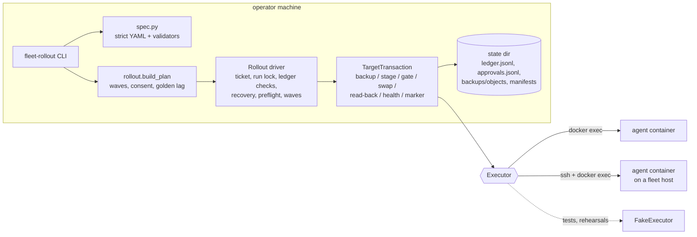
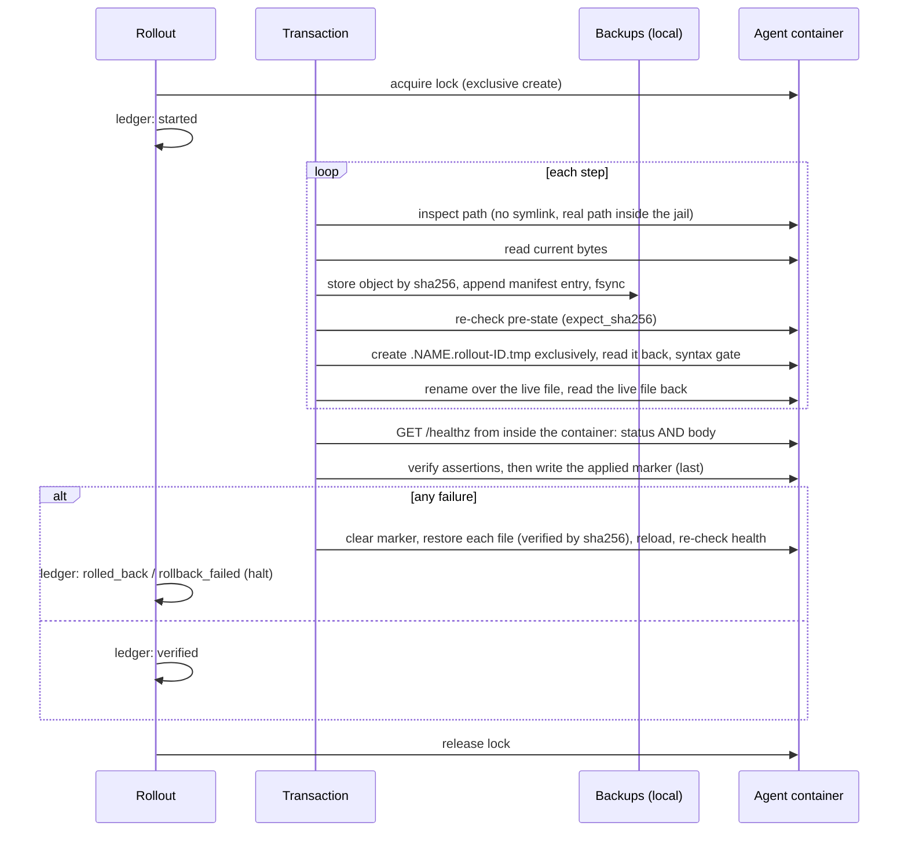

# fleet-rollout

**Transactional patch rollouts for fleets of containerized AI agents.** You describe a
change once, in a YAML patch spec. `fleet-rollout` validates the spec as hostile input,
then rolls it out canary first, one target at a time. Every target is a transaction:
backed up, swapped in, read back, and health-checked on the response *body*. A failure
restores that target from its checksummed backup and halts the rollout. Everything goes
into a hash-chained ledger.

It also ships a fail-closed **Claude Code PreToolUse hook** that stops an AI coding agent
from changing live containers unless the command carries an explicit change ticket.


```text
$ fleet-rollout apply patches/support-greeting-v2.yaml --ticket CHG-1042 --include-customer
run r-20261012t183952z-c39e: support-greeting-v2 (digest 54b0b30a237e), ticket CHG-1042, operator ops.oncall
  canary        agent-01     verified        healthy (attempt 1)
  cohort leads  agent-04     verified        healthy (attempt 1)
  cohort leads  agent-05     verified        healthy (attempt 1)
  remaining     agent-02     verified        healthy (attempt 1)
  remaining     agent-03     verified        healthy (attempt 1)
done: 5 verified, 0 skipped; ledger head 944eff514937683d

$ fleet-rollout apply patches/agent-config-v3.yaml --ticket CHG-1042
  canary        agent-01     rolled_back     health gate: HTTP 200 but body field 'status' is "degraded",
                expected "ok"; restored 1 file(s), each verified by checksum; healthy
HALTED at agent-01 (rolled_back). No later target was touched. The patch stays frozen until
someone investigates and runs `fleet-rollout clear-halt agent-config-v3`.
```

That second patch was valid JSON and passed every syntax check. It renamed a config key
the running agent did not know. The agent kept answering HTTP 200 and said `degraded` in
the body, and only the body check caught it.

## What's inside

| | |
|---|---|
| **Hostile-input patch specs** | Strict YAML (duplicate keys, anchors/aliases and merge keys are rejected). Every path, SQL identifier and command passes an allowlist before a plan exists. A spec can *name* an allowlisted command but cannot *express* one. |
| **Per-target transactions** | Checksummed backup, then stage the new file next to the target, read the staged copy back, run the syntax gate, atomic rename, read back the live file. Then a health gate on the response body, `verify` assertions, and an applied marker written last. Any failure restores the target and proves each restored file by sha256; a database row goes back column by column. |
| **Canary, then cohorts, then the rest** | The canary goes first, then one target from each remaining cohort, then everything else, internal targets before customer-owned ones. Rollouts are serial and stop at the first red. An optional bake period re-checks every patched target between waves. |
| **Ledger, locks, recovery** | An append-only, hash-chained JSONL ledger. Locks are taken on each target (atomic exclusive create on the target itself) and on the state directory. An interrupted transaction, of any patch, is undone from its write-ahead backup log before anything else touches that target. |
| **Drift against a golden template** | One golden workspace tree, rendered per target (`{{ fleet.target.name }}`, `{{ fleet.vars.region }}`), compared byte for byte with every target. Text differences come back as unified diffs, binary ones as checksums. |
| **Consent gates** | Customer-owned targets are held back unless explicitly included. Then they need **two approvals from two different people**, bound to the patch's digest, which covers the spec and every bundled byte. |
| **Guard hook for AI agents** | A PreToolUse hook that lexes shell commands, follows `ssh`, `docker exec`, `sh -c`, heredocs, `cd`, `sudo`/`env`/`xargs` and friends, and denies anything that would change a live container unless it carries a valid change ticket. It fails closed. |
| **Executors** | A small file-and-command interface with adapters for local `docker exec` and `docker exec` over SSH, plus an in-memory fake. The fake is held to the same contract tests as the real adapter running under a real `sh`. |
| **Tested without Docker** | 626 tests, offline, no keys. Includes real SQLite row upserts and restores, real shell scripts, and a loopback HTTP server. |

## Architecture



One target's transaction, with the restore path:



### The parts that are harder than they look

**1. YAML is not a safe format by default.** `yaml.safe_load` does not construct objects,
but it still lets a duplicate key win silently. `{dest: config/x, dest: ../../etc/x}`
loads as the second value while a reviewer reads the first. It also expands
anchors/aliases (a small file becomes a huge structure) and splices merge keys (`<<`).
[`yamlsafe.py`](src/fleet_rollout/yamlsafe.py) rejects all three. The validators had a
subtler trap: Python's `$` also matches *before a trailing newline*, so
`re.match(r"^[a-z]+$", "abc\n")` succeeds. A test caught `"config/greeting.txt\n"`
slipping through, and every validator now uses `fullmatch`. Text fields also reject
bidirectional and zero-width characters, so a reviewer sees exactly what will be written.

**2. A path string proves nothing about the disk.** Patch paths are relative to the
agent's workspace and validated (`[A-Za-z0-9._+-/]`, no `..`, nothing under the
engine's reserved directory). That is necessary but not sufficient: `cat > path`
follows symlinks, and so does `mkdir -p`. On the target itself, before the first write,
the transaction refuses a destination that is a symlink, or whose resolved real path
(including a symlinked parent directory) leaves the workspace. Staging first removes
whatever sits at the staging path (`rm` unlinks a planted symlink rather than following
it), then creates the file exclusively (`set -C`), so nothing can be slipped in between.

**3. The backup log is a write-ahead undo log.** Before a step mutates a file, its
current bytes go into a content-addressed store, and `{step, path, sha_before,
sha_after}` is appended and fsynced to the run's manifest. So whatever state a crash
leaves a target in, the next run of that patch finds the `started` record with no
terminal record, takes the lock, restores every logged file, and records `recovered`
before doing anything else. A run of any *other* patch refuses that target until the
interrupted transaction is undone; otherwise it would back up the half-applied files as
its own pre-state. An interruption the process survives (Ctrl-C, `SystemExit`) restores
the target on the way out and records `rolled_back`, so the ledger never shows `started`
for a target that was put back. Restores are verified in both directions. The backup
object must hash to its own name, and the staged restore must read back intact *before*
it is renamed over the live file. That second check was missing at first, and a
fault-injection test showed a lossy transfer during restore could land damaged bytes on
the live file.

A restore undoes *this* patch and nothing else. `sha_after` records what the step
installs, so a file that has changed since (a later patch to the same file, a hand
edit) is reported and left alone; `fleet-rollout rollback` refuses before touching
anything, and only `--force` (a person's decision) overwrites the later change. A
`sql_upsert` logs the row's previous values, and a restore puts those columns back (or
deletes a row the patch inserted). An earlier version swapped the whole database
file back, which silently deleted every row the agent had written since the patch.

**4. Health means the body.** A reverse proxy's catch-all route, a maintenance page, and
an agent that failed to load its config all answer 200. The fleet file refuses a health
check without a body expectation. The probe runs *inside* the container (`python3`'s
urllib against `127.0.0.1`), so it talks to the agent and not to whatever sits in front
of it. Preflight refuses a target that is already unhealthy: patching it would fail the
post-check for a fault the patch did not cause, and halt the fleet.

**5. Honest state beats optimistic state.** The applied marker is written last and
cleared first, so a re-run never mistakes a half-applied target for a finished one. A
restore that cannot prove every file, or cannot bring health back, is `rollback_failed`
rather than `rolled_back`, and it names the files that are still wrong. Reusing a patch
id for different content is refused, because "already applied" would then be a lie. An
unreachable target raises instead of reading as "file absent" (SSH exit 255 and Docker
exit 125 are transport errors, not answers).

**6. A command guard cannot be a regex.** `docker restart $(docker ps -q)`,
`ssh host 'sh -c "..."'`, `bash <<EOF`, `sudo env X=1 timeout 5 docker kill …`,
`DOCKER_HOST=ssh://… docker …`, `find … -exec docker restart {} \;` and
`echo '...' | bash` all hide the real target. The guard has its own POSIX-shell lexer
([`guard/shell.py`](src/fleet_rollout/guard/shell.py)): quotes, escapes, operators,
redirections, heredocs, `$(...)`, backticks and process substitution. It flattens every
command a script would run, and marks any word whose value is computed at run time. Each
command is then classified in context (this machine, a non-fleet host, a fleet host,
inside a fleet container). The classifier strips wrappers and re-parses `ssh` remote
commands and `sh -c` scripts. It reads local shell scripts from disk before they run, from
every directory a `cd` (or `env -C`) may have moved the shell into. `fleet-rollout` itself
is read the way its argparse parser reads it, and the CLI refuses abbreviated options
(`--fle` for `--fleet`), so the two cannot disagree about what a command line says.
Anything it cannot name is denied: no ticket can authorize a target nobody can identify.

## Quick start

Requirements: Python 3.11+. To use real targets, also the `docker` CLI (local) or `ssh`
access to each host, plus `sh` and `python3` inside each agent container.

```bash
git clone <this repository> fleet-rollout && cd fleet-rollout
python -m venv .venv && source .venv/bin/activate        # Windows: .venv\Scripts\activate
pip install -e ".[dev]"

fleet-rollout validate examples/patches/support-greeting-v2.yaml
fleet-rollout validate examples/patches/hostile-example.yaml     # refused, exit 2
fleet-rollout plan examples/patches/support-greeting-v2.yaml --fleet examples/fleet.yaml

python examples/rehearse_rollout.py     # the full story against five simulated agents
```

The example fleet is fictional (`agent-01` … `agent-05` on `*.example.com`). The rehearsal
script drives the real CLI through every feature against in-memory agents. It covers a
refused hostile spec, drift, the plan, two approvals, a clean rollout, a health failure
caught on the canary with a halt, `status`, and ledger verification.

Against a real fleet:

```bash
fleet-rollout plan    my-change.yaml --fleet fleet.yaml
fleet-rollout approve my-change.yaml --fleet fleet.yaml --target agent-03 \
      --approver ops.oncall --note "reviewed the diff"          # customer targets: 2 people
fleet-rollout apply   my-change.yaml --fleet fleet.yaml --ticket CHG-1042 --include-customer
fleet-rollout status  my-change.yaml --fleet fleet.yaml
fleet-rollout drift   --fleet fleet.yaml
fleet-rollout rollback my-change.yaml --fleet fleet.yaml --target agent-02 --ticket CHG-1042
fleet-rollout ledger verify --fleet fleet.yaml
```

| Command | What it does | Touches targets |
|---|---|---|
| `validate PATCH` | Load and validate a spec, print its steps and digest | no |
| `plan PATCH` | Waves, held-back and blocked targets, golden-template warnings | no |
| `apply PATCH --ticket ID` | The rollout. Needs `--include-customer` for customer targets | yes |
| `rollback PATCH --target T --ticket ID` | Restore one target to the pre-state its last run recorded; refused if a file or row changed since (`--force` overrides) | yes |
| `status PATCH` | Per-target state from the ledger, and any halt | no |
| `drift` | Diff every target against the rendered golden template | read-only |
| `approve PATCH --target T --approver P --note N` | Record one approval (bound to the patch digest) | no |
| `ledger verify` / `ledger show` | Check the hash chain and print the head hash | no |
| `clear-halt PATCH_ID --reason R` | Unfreeze a halted patch after investigating | no |
| `unlock T --ticket ID` / `unlock --run-lock --ticket ID` | Break-glass for a lock left by a dead run | lock only |
| `locks` | Who holds which lock, and for how long | read-only |

Exit codes: `0` success, `1` a rollout or check failed (or drift found), `2` invalid input,
`3` refused by a gate (ticket, consent, halt, lock) before anything changed.

## Patch specs

```yaml
id: support-greeting-v2                  # becomes file names, so [a-z0-9._-]
description: Friendlier greeting and a refund rule
steps:
  - kind: write_file                     # replace a file with one from the bundle
    source: files/greeting.txt           # relative to this spec; must stay inside it
    dest: config/greeting.txt            # relative to the agent's workspace root
    expect_sha256: ff10fb…               # optional: refuse if someone hand-edited it
  - kind: append_block                   # append once, identified by a marker line
    source: files/refund-rule.md
    dest: prompts/support.md
    marker: "<!-- rule: refunds-v2 -->"
  - kind: sql_upsert                     # one row, bound parameters, read back
    db: data/settings.db
    table: settings
    key_column: name
    key: invoice_template
    values: {value: v2}
  - kind: run                            # a NAME from the allowlist, never a command
    command: reload_agent
verify:
  - file: config/greeting.txt
    contains: Thanks for reaching out
```

Syntax gates run on the staged copy before it can replace the live file. `.py` files
(by source *or* destination name) are compiled on the target with its own interpreter,
without writing bytecode. `.json`, `.yaml`/`.yml` and `.toml` are parsed from the bytes
read back.

| `run` command | Runs | Read-back |
|---|---|---|
| `compile_python` | `python3 -c <compile>` on 1-8 files | exit status |
| `make_dirs` | `mkdir -p --` on 1-8 paths | each path is a directory |
| `make_executable` | `chmod 0755 --` on 1-8 paths | `test -x` on each |
| `reload_agent` | `kill -HUP 1` | health gate; re-run after any restore |

Limits: specs up to 64 KiB, bundled files up to 1 MiB, 50 steps, 32 columns per upsert.
One file per step: two steps may not write the same path, so every backup is an exact
pre-state.

## Configuration

The fleet file ([example](examples/fleet.yaml)):

| Key | Default | |
|---|---|---|
| `fleet` | required | fleet name |
| `golden` | none | golden template directory (relative to the fleet file) |
| `tickets_dir` | none | change tickets; without it no ticket can be valid |
| `state_dir` | `.fleet-state` | ledger, approvals, backups, run lock. Commands that write state always use it; `--state` only redirects read-only ones (`plan`, `status`, `ledger`, `locks`) |
| `defaults.executor` | none | `docker` (local `docker exec`) or `ssh` (`ssh host -- docker exec`) |
| `defaults.root` | none | the workspace jail inside each container (never `/`) |
| `defaults.health` | none | `port`, `path` and at least one of `expect_json` / `expect_body` / `expect_contains`; optional `expect_status` (200), `retries` (3), `interval_seconds` (2), `timeout_seconds` (5) |
| `targets[].name`, `host`, `owner` | required | `owner` is `internal` or `customer` and cannot be defaulted |
| `targets[].container` | the name | Docker container name |
| `targets[].cohort` | `default` | used to pick the second wave |
| `targets[].canary` | `false` | at most one, never customer-owned |
| `targets[].customer`, `vars` | none | display name; template variables |

| Environment variable | |
|---|---|
| `FLEET_ROLLOUT_OPERATOR` | operator id when `--operator` is not given (default: the login name, lowercased) |
| `CLAUDE_PROJECT_DIR` | set by Claude Code; the guard protects `.claude/settings*.json` under it |

## The guard hook

Install it with the settings in [`examples/claude-settings.json`](examples/claude-settings.json):

```json
{"hooks": {"PreToolUse": [{"matcher": "Bash|Write|Edit|MultiEdit|NotebookEdit",
  "hooks": [{"type": "command",
             "command": "fleet-rollout-guard --fleet \"$CLAUDE_PROJECT_DIR/fleet.yaml\""}]}]}}
```

| The agent runs | Guard |
|---|---|
| `docker ps`, `docker logs agent-02`, `docker exec agent-01 cat …`, `ssh edge-1.example.com 'docker logs agent-01 \| tail'` | allowed (reads) |
| `docker restart agent-01`, `ssh edge-1.example.com reboot`, `scp x edge-1.example.com:/srv/` | denied: needs a ticket |
| `CHANGE_TICKET=CHG-1042 docker restart agent-01` | allowed if the ticket is valid, unexpired and covers agent-01 |
| `docker rm -f $(docker ps -aq)`, `for c in …; do docker restart $c; done`, `echo … \| bash` | denied: target computed at run time / script not inspectable |
| `fleet-rollout apply … --ticket CHG-1042` | allowed if the ticket covers every selected target |
| `fleet-rollout approve …`, `fleet-rollout clear-halt …`, `fleet-rollout rollback … --force` | denied: those are human decisions |
| `fleet-rollout apply … --state /tmp/x`, `--fleet other.yaml`, `cd elsewhere && fleet-rollout apply …` | denied: a mutation must use the fleet file the guard protects and that fleet's state directory, or it could bring its own targets, tickets, approvals and halts |
| `uv run fleet-rollout …`, `python -c` code that imports `fleet_rollout`, an abbreviated option | denied: run the CLI directly, with options spelled out |
| writing tickets, the state dir, the fleet file or `.claude/settings*.json` (Bash or Write/Edit) | denied |
| a payload it cannot read, a command it cannot parse, an unknown `cwd`, an internal error | denied (fail closed) |

A ticket (`tickets/CHG-1042.yaml`) lists the targets it covers, its approvers and an
expiry with a timezone. `*` covers internal targets only. A customer-owned target must
be named explicitly, and the ticket needs two different approvers. The guard never
prints `allow`, so everything it lets through still goes through Claude Code's normal
permission prompts.

## Testing

```bash
pytest -q                       # 626 tests, under a minute, offline; no Docker, SSH or keys
ruff check src tests examples
python examples/rehearse_rollout.py
```

On Windows, 4 contract tests that need POSIX symlinks or exec bits are skipped; CI runs
all of them on Linux.

- [`tests/test_executor_contract.py`](tests/test_executor_contract.py) runs one
  behavioural contract against the in-memory `FakeExecutor` *and* against the real
  container adapter executing its shell scripts under a local `sh`. The fake cannot
  quietly drift from reality.
- [`tests/test_transaction.py`](tests/test_transaction.py) injects faults at every
  stage (syntax errors, a lossy transport, a read-only filesystem mid-step, Ctrl-C,
  a tampered backup, a restore that cannot write, a later change a restore must not
  overwrite). Every case asserts the target ends in its pre-state (files byte-identical,
  rows holding their previous values), or is reported as a partial restore naming what
  is still wrong.
- [`tests/test_rollout.py`](tests/test_rollout.py) drives five fake agents through
  waves, halts, resume, crash recovery from a half-applied target (including one left by
  another patch, and one fixed by hand since), bake checks and ledger write failures.
- [`tests/test_guard.py`](tests/test_guard.py) is a table of more than 80 real-world
  commands with the expected decision, and runs the installed hook entry point as a
  subprocess.
- [`tests/test_scripts.py`](tests/test_scripts.py) runs the on-target programs for real:
  SQLite row reads, upserts and restores against a temp database (including injection
  attempts) and the HTTP probe against a loopback server.

## Security notes

- **The guard is a guardrail, not a sandbox.** It inspects the command line, and the
  shell scripts that line runs from disk. It cannot see inside a Python program or a
  Makefile. A program it does not understand is allowed unless it names a fleet target,
  host or container (`python manage.py restart agent-02` is denied). The real boundary
  is credentials: an agent session should not hold production SSH keys or a production
  Docker socket. Pair the hook with OS permissions that make the tickets and state
  directories read-only to the agent's user.
- **Approvals and tickets are files.** The guard stops an agent from writing them. People
  with write access to the state directory can still edit `approvals.jsonl`. The ledger
  records which approvals each customer-target transaction relied on, so edits are
  visible after the fact.
- **The ledger's hash chain** detects edits, deletions and reordering. It cannot detect
  records cut off the *end*, so `ledger verify` prints the head hash: pin it somewhere
  the ledger's writer cannot edit (a ticket, a CI log) and compare.
- **SSH** runs with `BatchMode=yes` and relies on your `known_hosts`. The remote command
  is built with `shlex.join`, and paths are only ever positional arguments to fixed
  scripts.
- **Not undone by a restore:** directories created by `make_dirs` and permission changes
  made by `make_executable`. `reload_agent` is re-run after a restore so the agent picks
  up the restored files. A `sql_upsert` is undone row by row, so rows the agent wrote
  since are kept. It refuses a database with a non-empty write-ahead log, because the
  byte-level copy it also keeps would not be a consistent snapshot.

## Roadmap

- A Kubernetes executor (`kubectl exec`), and the guard rules to match
- Parallel cohorts with a concurrency limit, keeping the canary serial
- Signed tickets and approvals, so authorization does not rest on file permissions
- Remote state backends (object storage with conditional writes) for multi-operator teams
- `fleet-rollout plan --json` for review bots

## License

MIT
